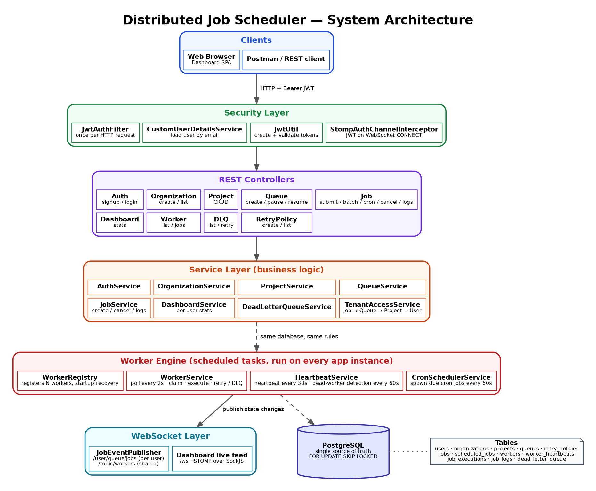
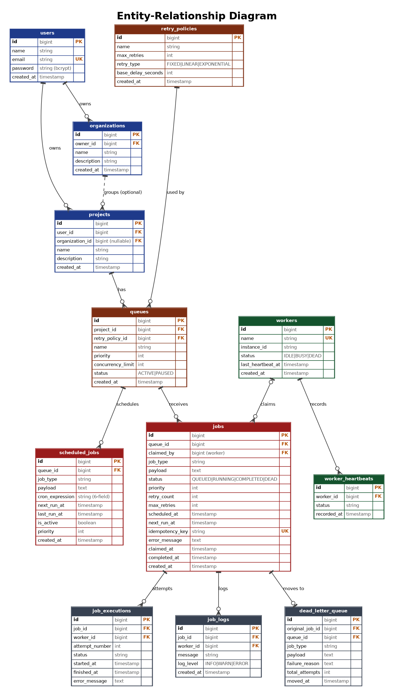
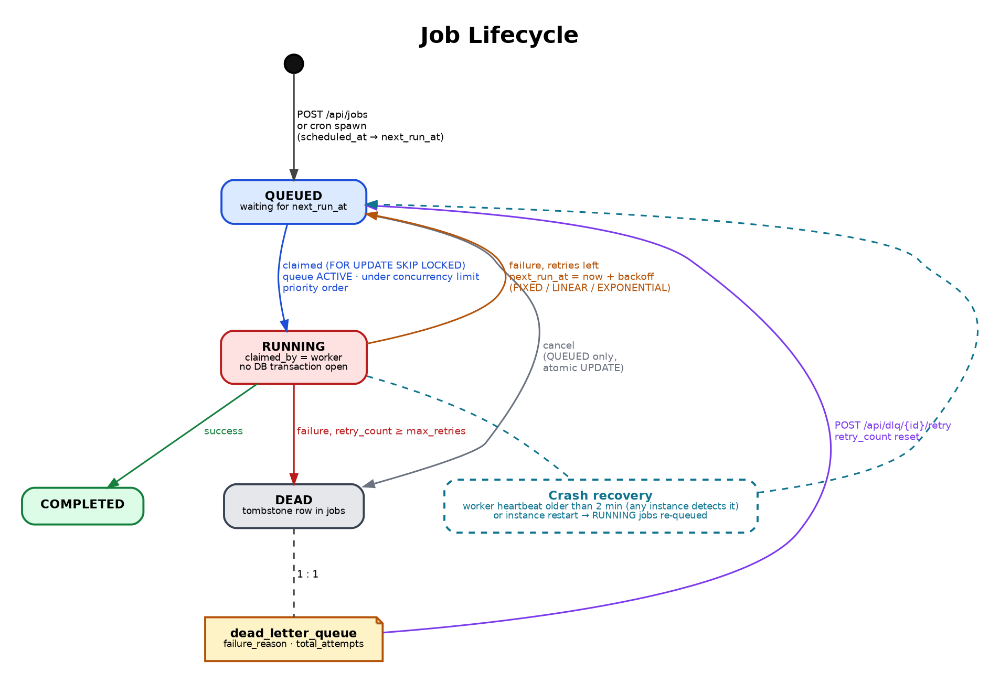

# Distributed Job Scheduler (Spring Boot + PostgreSQL + Docker)

A multi-tenant, distributed job scheduling system built with Java Spring Boot and PostgreSQL. It supports background job execution, cron-based recurring jobs, retry with configurable backoff, a dead letter queue, crash recovery across multiple app instances, and a live monitoring dashboard over WebSocket. The whole stack (app + database) starts with one `docker compose up`.

---

## System Architecture



The system is built in clean layers:

- **Client layer** — a browser dashboard and REST API clients talk HTTP with JWT bearer tokens
- **Security layer** — every request passes through `JwtAuthFilter` before reaching a controller
- **Controller layer** — thin REST endpoints that delegate to services
- **Service layer** — all business logic. `TenantAccessService` is the single place that checks "does this resource belong to the logged-in user?" Dashboard stats and WebSocket job events are scoped the same way
- **Worker engine** — scheduled tasks on a thread pool: job polling, heartbeats, dead-worker recovery, cron spawning
- **WebSocket layer** — `JobEventPublisher` broadcasts job and worker state changes
- **PostgreSQL** — single source of truth, with row-level locking (`FOR UPDATE SKIP LOCKED`) for atomic claiming

---

## Database Design



### Schema overview

| Table | Purpose |
|---|---|
| `users` | Authentication — email + bcrypt password |
| `organizations` | Grouping owned by a user (optional link from projects) |
| `projects` | Owned by a user, groups queues. This is the tenant boundary |
| `queues` | Named channel — priority, concurrency limit, retry policy |
| `retry_policies` | Reusable retry config — FIXED / LINEAR / EXPONENTIAL |
| `jobs` | Core unit of work — status, payload, scheduling, idempotency |
| `scheduled_jobs` | Cron job templates that spawn job instances |
| `workers` | Registered worker threads — status, last heartbeat, owning `instance_id` |
| `worker_heartbeats` | Heartbeat history — one row per 30s per live worker |
| `job_executions` | One row per attempt — started/finished/error |
| `job_logs` | Append-only log lines per job — INFO / WARN / ERROR |
| `dead_letter_queue` | Permanently failed jobs — available for manual retry |

### Key design choices

- `jobs.idempotency_key` — unique constraint prevents duplicate job creation
- `jobs.next_run_at` — controls when new, delayed, or retried jobs become claimable
- `jobs.claimed_by` — FK to `workers`, null until claimed
- `workers.instance_id` — which app instance (JVM) owns the worker; lets several instances share one database
- `retry_policies` is a separate table — reusable across queues

Design trade-offs are written up in [DESIGN_DECISIONS.md](DESIGN_DECISIONS.md).

---

## Job Lifecycle



```
QUEUED ──claimed by worker──▶ RUNNING ──▶ COMPLETED
  ▲                              │
  │                              └─ failure
  │                                   ├─ retries left ──▶ QUEUED  (next_run_at = now + backoff)
  │                                   └─ retries used up ─▶ DEAD  + row in dead_letter_queue
  │
  └── POST /api/dlq/{id}/retry  (resets retry_count)

PUT /api/jobs/{id}/cancel  (QUEUED jobs only) ──▶ DEAD
```

Future-dated jobs stay `QUEUED` until `next_run_at` passes. `FAILED` is recorded on individual `job_executions` rows (one per attempt), not on the job itself.

---

## Tech Stack

| Technology | Version | Purpose |
|---|---|---|
| Java | 21 | Language |
| Spring Boot | 4.0.8 | Framework |
| Spring Security | 7.x | Auth and endpoint protection |
| Spring Data JPA | 4.x | ORM and repository layer |
| PostgreSQL | 14+ (16 in Docker) | Database + row-level locking |
| JJWT | 0.12.3 | JWT generation and validation |
| Springdoc OpenAPI | 3.0.3 | Swagger docs |
| Spring WebSocket | Spring Framework 7 | STOMP over SockJS live updates |
| Lombok | 1.18.x | Boilerplate reduction |
| JUnit 5 + Mockito | via Spring Boot | Unit and integration tests |

---

## Setup

### Option 1: Docker (recommended)

**1. Clone**

```bash
git clone <repo-url>
cd job-scheduler
```

**2. Configure** — create a `.env` file next to `docker-compose.yml`:

```properties
POSTGRES_DB=job_scheduler
POSTGRES_USER=postgres
POSTGRES_PASSWORD=change-me

# Inside Compose the database host is the service name "postgres"
SPRING_DATASOURCE_URL=jdbc:postgresql://postgres:5432/job_scheduler
SPRING_DATASOURCE_USERNAME=postgres
SPRING_DATASOURCE_PASSWORD=change-me

SPRING_JPA_HIBERNATE_DDL_AUTO=update
SPRING_JPA_DATABASE_PLATFORM=org.hibernate.dialect.PostgreSQLDialect

JWT_SECRET=replace-with-a-random-string-of-32-or-more-characters
JWT_EXPIRATION=86400000
SERVER_PORT=8080
```

**3. Run**

```bash
docker compose up --build
```

**4. Default admin** (created on first start — change it before any real deployment)

```
Email:    admin@jobscheduler.com
Password: Admin@123
```

**5. Access**

| URL | Description |
|---|---|
| `http://localhost:8080/dashboard.html` | Live monitoring dashboard |
| `http://localhost:8080/swagger-ui.html` | Interactive API docs |

PostgreSQL is published on host port `5434` for debugging.

### Option 2: Local development

Requires Java 21+, PostgreSQL 14+, Maven 3.8+.

**1. Create the database**

```sql
CREATE DATABASE job_scheduler;
```

**2. Configure.** `application.properties` reads everything from environment variables. Locally it defaults to `jdbc:postgresql://localhost:5433/job_scheduler` with user `postgres`. The password and JWT secret have no defaults. Either export them:

```bash
export SPRING_DATASOURCE_PASSWORD=your_password
export JWT_SECRET=your-secret-key-at-least-32-characters-long
```

or put overrides in an untracked `local.properties` in the project root (imported automatically if present):

```properties
spring.datasource.url=jdbc:postgresql://localhost:5432/job_scheduler
spring.datasource.password=your_password
jwt.secret=your-secret-key-at-least-32-characters-long
```

**3. Run**

```bash
./mvnw spring-boot:run
```

### Configuration reference

| Variable | Default | Description |
|---|---|---|
| `SPRING_DATASOURCE_URL` | `jdbc:postgresql://localhost:5433/job_scheduler` | JDBC URL |
| `SPRING_DATASOURCE_USERNAME` | `postgres` | DB user |
| `SPRING_DATASOURCE_PASSWORD` | — (required) | DB password |
| `SPRING_JPA_HIBERNATE_DDL_AUTO` | `update` | Schema management |
| `JWT_SECRET` | — (required) | HMAC key, 32+ characters |
| `JWT_EXPIRATION` | `86400000` | Token lifetime in ms (24h) |
| `SERVER_PORT` | `8080` | HTTP port |
| `WORKER_COUNT` | `3` | Worker threads per app instance |
| `WORKER_INSTANCE_ID` | `<hostname>-<port>` (`job-scheduler-app` in Compose) | Stable ID for this instance's workers |

---

## API Reference

All endpoints except `/api/auth/**` require `Authorization: Bearer <token>`. Resources are scoped to the owning user: a missing resource returns `404`, someone else's returns `403`.

### Auth
| Method | Endpoint | Auth | Description |
|---|---|---|---|
| POST | `/api/auth/signup` | No | Register user |
| POST | `/api/auth/login` | No | Login, get JWT |

### Organizations
| Method | Endpoint | Auth | Description |
|---|---|---|---|
| POST | `/api/organizations` | Yes | Create organization |
| GET | `/api/organizations` | Yes | List my organizations |

### Projects
| Method | Endpoint | Auth | Description |
|---|---|---|---|
| POST | `/api/projects` | Yes | Create project |
| GET | `/api/projects` | Yes | List my projects |
| GET | `/api/projects/{id}` | Yes | Get project |
| PUT | `/api/projects/{id}` | Yes | Update project |
| DELETE | `/api/projects/{id}` | Yes | Delete project |

### Retry Policies
| Method | Endpoint | Auth | Description |
|---|---|---|---|
| POST | `/api/retry-policies` | Yes | Create retry policy |
| GET | `/api/retry-policies` | Yes | List all policies |

### Queues
| Method | Endpoint | Auth | Description |
|---|---|---|---|
| POST | `/api/projects/{id}/queues` | Yes | Create queue |
| GET | `/api/projects/{id}/queues` | Yes | List queues |
| PUT | `/api/projects/{id}/queues/{qId}/pause` | Yes | Pause queue |
| PUT | `/api/projects/{id}/queues/{qId}/resume` | Yes | Resume queue |
| DELETE | `/api/projects/{id}/queues/{qId}` | Yes | Delete queue |

### Jobs
| Method | Endpoint | Auth | Description |
|---|---|---|---|
| POST | `/api/jobs` | Yes | Submit single job |
| POST | `/api/jobs/batch` | Yes | Submit multiple jobs |
| POST | `/api/jobs/scheduled` | Yes | Create recurring cron job |
| GET | `/api/jobs/scheduled` | Yes | List my cron schedules |
| PUT | `/api/jobs/scheduled/{id}/deactivate` | Yes | Deactivate cron job |
| GET | `/api/jobs/{id}` | Yes | Get job status |
| GET | `/api/jobs/{id}/logs` | Yes | Get job logs |
| GET | `/api/jobs/queue/{queueId}?page=0&size=20` | Yes | Jobs by queue (paginated) |
| GET | `/api/jobs/status/{status}?page=0&size=20` | Yes | My jobs by status (paginated) |
| PUT | `/api/jobs/{id}/cancel` | Yes | Cancel a queued job (not allowed once claimed) |

### Monitoring
| Method | Endpoint | Auth | Description |
|---|---|---|---|
| GET | `/api/dashboard` | Yes | Your job/queue/DLQ stats + shared worker counts |
| GET | `/api/workers` | Yes | Worker status (all instances) |
| GET | `/api/workers/{id}/jobs` | Yes | My jobs currently running on a worker |
| GET | `/api/dlq` | Yes | My dead letter queue entries |
| POST | `/api/dlq/{id}/retry` | Yes | Re-queue a dead job |

### Cron expressions

Schedules use Spring's six-field format: `second minute hour day-of-month month day-of-week`, e.g. `0 0 9 * * MON-FRI` for 09:00 on weekdays (server time zone). Due schedules are checked every 60 seconds and locked with `SKIP LOCKED`, so with several instances exactly one spawns each run.

---

## Concurrency — How Atomic Claiming Works

If two workers poll at the same moment, only one may claim a given job:

```sql
SELECT j.* FROM jobs j
JOIN queues q ON j.queue_id = q.id
WHERE j.status = 'QUEUED'
AND q.status = 'ACTIVE'
AND j.next_run_at <= NOW()
AND (
    SELECT COUNT(*) FROM jobs running
    WHERE running.queue_id = j.queue_id
    AND running.status = 'RUNNING'
) < q.concurrency_limit
ORDER BY q.priority DESC, j.priority DESC, j.created_at ASC
FOR UPDATE OF j SKIP LOCKED
LIMIT 1
```

- `FOR UPDATE` — exclusive row lock on the chosen job
- `SKIP LOCKED` — other workers skip locked rows instead of waiting
- `LIMIT 1` — one job per claim

How a job flows through a worker (`WorkerService`):

1. **Poll** (every 2s): each idle worker of this instance claims a job in a short transaction (job → `RUNNING`, worker → `BUSY`) and hands it to the thread pool. The transaction commits before any work starts.
2. **Execute** on a pool thread with **no database transaction open**, so a slow job never holds a connection or a lock.
3. **Finish** in a second short transaction: the job row is locked and re-checked. If it was reassigned while running (for example after a false dead-worker detection), the late result is discarded and recorded on the execution row.

Result: no duplicate execution, even with many workers across several instances.

---

## Multiple Instances and Crash Recovery

Every app instance registers `WORKER_COUNT` workers named `<instance-id>-worker-N`. The database is the only coordination point, so you can run several instances against one PostgreSQL.

- **Heartbeats** — each instance refreshes its own workers' `last_heartbeat_at` every 30s and records a history row
- **Dead worker detection** — every 60s, *any* instance looks for workers whose heartbeat is older than 2 minutes, marks them `DEAD`, and re-queues their `RUNNING` jobs. A surviving instance therefore recovers a crashed one
- **Restart recovery** — on startup an instance re-queues jobs still `RUNNING` under its own previous workers
- **Graceful shutdown** — `@PreDestroy` stops polling and waits up to 30s for in-flight jobs

---

## Retry Strategies

| Strategy | Formula | Example (base = 30s) |
|---|---|---|
| FIXED | base | 30s → 30s → 30s |
| LINEAR | base × attempt | 30s → 60s → 90s |
| EXPONENTIAL | base × 2^(attempt−1) | 30s → 60s → 120s → 240s |

Delays are capped at 24 hours. A job moves to the DLQ once its failed attempts reach `max_retries` (so `max_retries = 3` means three attempts in total). Queues without a policy use 3 attempts, EXPONENTIAL, 30s base. Policies live in `retry_policies` and are shared across queues.

---

## Failure Scenarios Handled

| Scenario | Solution |
|---|---|
| Two workers claim the same job | `FOR UPDATE SKIP LOCKED` — impossible by design |
| Instance crashes mid-execution | Heartbeat goes stale for 2 min → another instance marks workers `DEAD` and re-queues their jobs |
| Instance restarts | Its previously `RUNNING` jobs are re-queued at startup |
| Result arrives after job was reassigned | Row lock + ownership check; stale result is discarded |
| Job fails repeatedly | Retry with backoff → DLQ after `max_retries` |
| Duplicate job submission | `idempotency_key` unique constraint; a racing insert returns the winning row |
| Queue overloaded | `concurrency_limit` caps parallel jobs per queue |
| Queue paused | Claim query skips it and new submissions are rejected |
| Cancel races a worker claim | Cancel is one atomic `UPDATE ... WHERE status = 'QUEUED'`; if a worker won, cancel is refused |
| Graceful shutdown | Polling stops, in-flight jobs get up to 30s to finish |
| Access to another user's data | `TenantAccessService` returns 403 |

---

## WebSocket Live Updates

The dashboard connects via STOMP over SockJS at `/ws`. The JWT must be sent in the STOMP `CONNECT` headers (`StompAuthChannelInterceptor` rejects anything else), and subscriptions are limited to:
- `/user/queue/jobs` — state transitions of *your own* jobs only
- `/topic/workers` — worker status changes (shared infrastructure)

It shows toast notifications in real time and refreshes by polling every 10 seconds as a fallback.

---

## Running Tests

```bash
./mvnw test
```

29 tests in 7 classes. The integration tests use a real PostgreSQL (the configured datasource), so the database must be reachable. Stop the app first — `ConcurrentClaimTest` would otherwise compete with the app's own workers.

| Class | Type | Covers |
|---|---|---|
| `JobServiceUnitTest` | Mockito | Creation, idempotency and its race, paused queue, cancel rules, tenant isolation |
| `WorkerServiceUnitTest` | Mockito | Shutdown flag, no idle workers, stop after first empty claim |
| `JobServiceTest` | Integration | Creation, idempotency, paused queue, cross-user isolation |
| `WorkerServiceTest` | Integration | Priority order, paused queue, future jobs, concurrency limit |
| `ConcurrentClaimTest` | Integration | 8 threads race for 40 jobs; each is claimed exactly once |
| `RetryBackoffTest` | Unit | FIXED / LINEAR / EXPONENTIAL delays and the 24h cap |
| `JobSchedulerApplicationTests` | Integration | Application context loads |

---

## Known Limitations

- Job execution is simulated: `WorkerService` sleeps 1–3s and fails 20% of jobs at random so retries and the DLQ can be exercised. Real work needs a handler per `job_type`
- `organizations` can be created but projects are not yet linked to them
- `concurrency_limit` is checked inside the claim query; across several instances it can briefly overshoot
- `worker_heartbeats` has no retention policy

---

## Project Structure

```
src/main/java/com/placements/job_scheduler/
├── config/          SecurityConfig, SchedulerConfig, WebSocketConfig, OpenApiConfig, DataInitializer
├── controller/      REST endpoints — thin, no business logic
├── dto/             Request and response objects
│   ├── request/     CreateJobRequest, CreateQueueRequest, ...
│   └── response/    JobResponse, DashboardResponse, ...
├── entity/          JPA entities — one per database table
├── enums/           JobStatus, QueueStatus, WorkerStatus, RetryType
├── exception/       GlobalExceptionHandler, ResourceNotFoundException, ForbiddenException
├── repository/      Spring Data JPA repositories (claim query lives in JobRepository)
├── security/        JwtAuthFilter, JwtUtil, CustomUserDetailsService, CurrentUserProvider
├── util/            RetryBackoff — backoff delay calculation
└── service/         Business logic
    ├── WorkerService.java        — polling, claiming, executing, retry/DLQ handling
    ├── WorkerRegistry.java       — registers this instance's workers, startup recovery
    ├── HeartbeatService.java     — heartbeats + dead-worker detection
    ├── CronSchedulerService.java — recurring job spawning
    ├── TenantAccessService.java  — ownership checks (Job → Queue → Project → User)
    ├── DeadLetterQueueService.java
    └── JobEventPublisher.java    — WebSocket broadcasting

src/main/resources/
├── application.properties
└── static/dashboard.html         — single-page monitoring dashboard

src/test/java/com/placements/job_scheduler/
├── service/   JobServiceUnitTest, WorkerServiceUnitTest, JobServiceTest, WorkerServiceTest, ConcurrentClaimTest
├── util/      RetryBackoffTest
└── JobSchedulerApplicationTests.java

Dockerfile, docker-compose.yml, DESIGN_DECISIONS.md, docs/ (diagrams)
```
